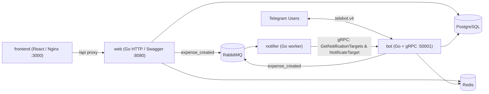

# SplitCore

[](https://github.com/GanFay/SplitCore/actions/workflows/ci.yml)

Shared expense tracker with a Telegram bot and a React web dashboard. Create a fund, add real or virtual members, log expenses, and calculate the minimum set of transfers needed to settle up.


## Architecture



- **`backend/cmd/web`**: REST API (`/api/v1/*`), Swagger docs, and Telegram deep-link auth issuing JWT access tokens + HTTP-only refresh cookies.
- **`backend/cmd/bot`**: Telegram bot (`telebot.v4`) and gRPC server (`:50001`) for sending notifications.
- **`notifier`**: Consumes `expense_created` events from RabbitMQ and asks `bot` over gRPC to notify fund members.
- **`frontend`**: React 19 + Tailwind SPA served by Nginx (proxies `/api/` to `web:8080`).

## Stack

- **Backend / Worker:** Go 1.26, `net/http`, `telebot.v4`, `pgx`, `go-redis`, `amqp091-go`, gRPC / Protobuf, `swaggo`
- **Frontend:** React 19, TypeScript, Vite, Tailwind CSS, Nginx
- **Infra:** PostgreSQL 18, Redis 8, RabbitMQ 4, Docker Compose, Caddy (production HTTPS)

## Run Locally

1. Copy the env template and set your Telegram bot token, bot username, JWT secrets, and DB/Redis/RabbitMQ credentials:
   ```bash
   cp backend/.env.example backend/.env
   ```

2. Start the database, Redis, and RabbitMQ, apply migrations, and build/start all services:
   ```bash
   make env-up
   make migrate-up
   make run-services
   ```

3. Open:
   - Web dashboard: `http://localhost:3000`
   - Swagger API docs: `http://localhost:8080/api/v1/swagger/index.html`
   - RabbitMQ UI: `http://localhost:15672`

## Development

```bash
cd backend && go test ./...           # Run backend unit tests
cd frontend && pnpm install && pnpm dev  # Local frontend dev server
make proto-generate                      # Regenerate protobuf Go stubs
make lint-app && make lint-notify        # Run golangci-lint
```

## Production (`docker-compose.prod.yaml`)

Uses prebuilt GHCR images behind Caddy (`Caddyfile.prod`) with `FRONTEND_DOMAIN`, `BACKEND_DOMAIN`, and `ACME_EMAIL` configured in `backend/.env`:

```bash
docker compose --env-file backend/.env -f docker-compose.prod.yaml pull
docker compose --env-file backend/.env -f docker-compose.prod.yaml --profile tools run --rm migrate
docker compose --env-file backend/.env -f docker-compose.prod.yaml up -d
```

## License

[LICENSE](LICENSE)
